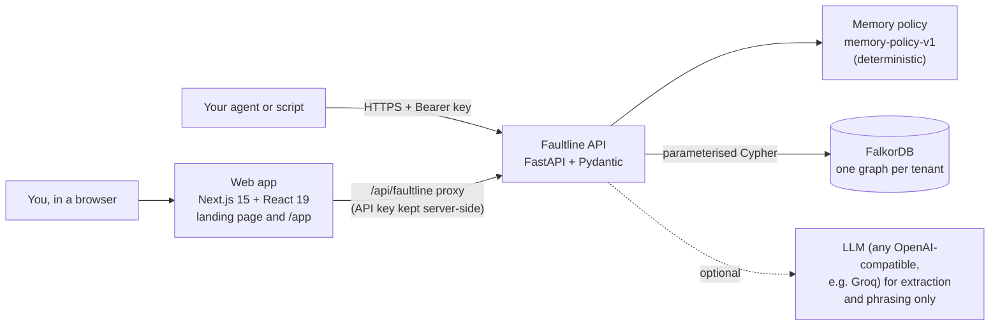
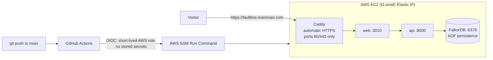
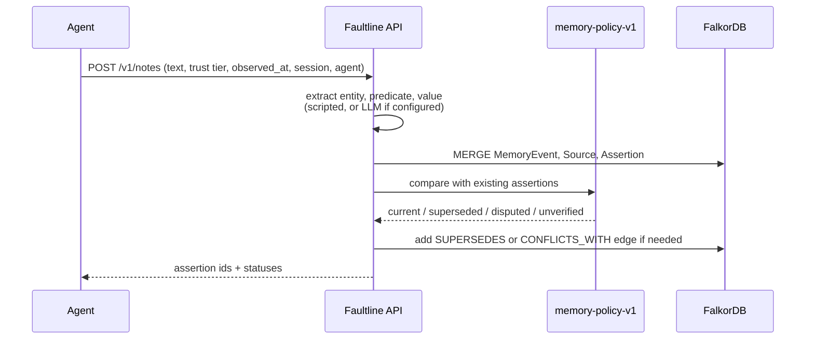
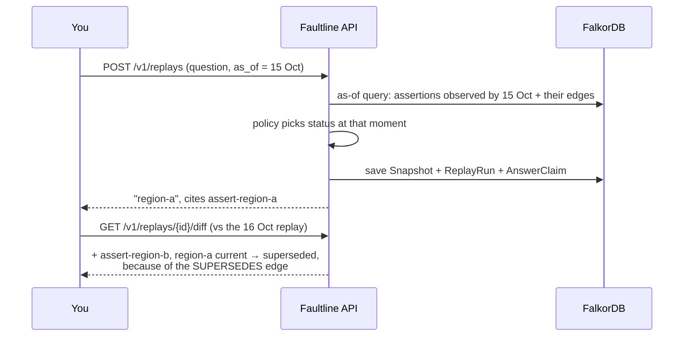
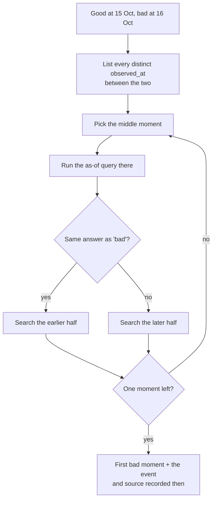
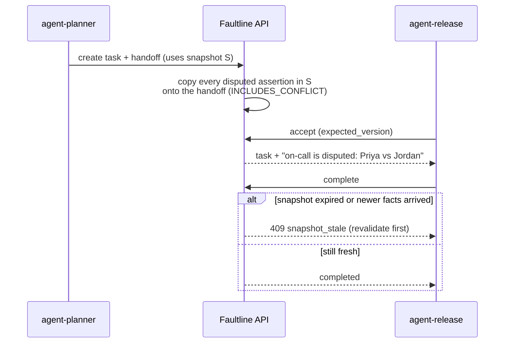
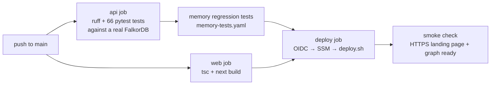
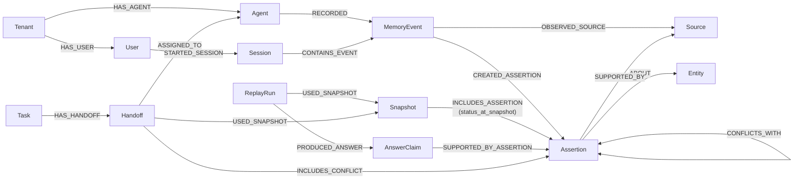

# Faultline: git for agent memory

[](https://github.com/maannaan/faultline/actions/workflows/deploy.yml)

**Live demo: https://faultline.mannnan.com** · Demo video: _link added after recording_ · [Graph Hacks](https://www.wemakedevs.org/hackathons/falkordb) **Track 02: Agent Memory and Coordination** · Built on [FalkorDB](https://www.falkordb.com)

> Your AI agent said `region-a` yesterday and `region-b` today. Was that a fix or a bug? Which note changed its mind? Who else already acted on the old answer?
> Faultline answers those questions the way `git` answers them for code.

---

## Contents

1. [What Faultline is, in plain words](#1-what-faultline-is-in-plain-words)
2. [Who it's for](#2-who-its-for)
3. [Try it in two minutes (no install)](#3-try-it-in-two-minutes-no-install)
4. [The seven commands](#4-the-seven-commands)
5. [How it works](#5-how-it-works)
6. [Architecture](#6-architecture)
7. [Flow diagrams](#7-flow-diagrams)
8. [Graph model](#8-graph-model)
9. [Setup guide: run it on your machine](#9-setup-guide-run-it-on-your-machine)
10. [Using the API](#10-using-the-api)
11. [Deploying your own copy](#11-deploying-your-own-copy)
12. [Testing and proof](#12-testing-and-proof)
13. [Cypher that does the work](#13-cypher-that-does-the-work)
14. [Track 02 coverage](#14-track-02-coverage)
15. [Limits, FAQ and glossary](#15-limits-faq-and-glossary)
16. [Project layout](#16-project-layout)
17. [AI assistance](#17-ai-assistance)

---

## 1. What Faultline is, in plain words

AI agents remember things: facts from documents, notes from users, decisions from other agents. Most agent memory today is a pile of text or a key-value store where **new facts overwrite old ones**. When an agent gives a wrong or changed answer, there's no way to see what it knew at that moment, or why.

Faultline stores agent memory as a **graph that never forgets**:

- Every fact is an **assertion** ("Project Atlas deploys to region-b").
- Every assertion is linked to **where it came from** (a source document), **when it was learned**, and **which agent recorded it**.
- When a fact is corrected, the old one is not deleted. A `SUPERSEDES` edge points from the new fact to the old one.
- When two trusted sources disagree, both are kept and joined by a `CONFLICTS_WITH` edge. Faultline refuses to quietly pick a winner.

Because the whole history is kept, you can rewind memory to any moment, compare two moments, and trace any answer back to its origin. That's what developers already do with code using `git checkout`, `git diff`, `git blame` and `git bisect`.

## 2. Who it's for

- **Teams building AI agents** who need to debug why an agent's answer changed.
- **Multi-agent systems**, where one agent hands work to another and must not lose an open question on the way.
- **Anyone who needs an audit trail**: "On 15 October, what did the agent know, and from which source?"

## 3. Try it in two minutes (no install)

Open **https://faultline.mannnan.com** and click **Open the app**. The demo uses a made-up rollout called **Project Atlas**:

1. A design note says the deploy region is `region-a` (15 Oct).
2. A reviewed change record corrects it to `region-b` (16 Oct).
3. Two equally trusted sources disagree on who is on call: Priya or Jordan.

Then click through:

| Step | Page | What to click | What you'll see |
| --- | --- | --- | --- |
| 1 | [Timeline](https://faultline.mannnan.com/app/timeline) | **Replay history** | The memory graph rebuilds itself over time. `region-a` turns grey when it's corrected |
| 2 | [Replay / Diff](https://faultline.mannnan.com/app/replay) | **Run replay**, then tick **Counterfactual** and run again | The same question asked on two dates, and the exact edge that changed the answer |
| 3 | [Blame](https://faultline.mannnan.com/app/blame) | **Ask: Region · 16 Oct** | The answer traced back to the source, the event, the session and the agent |
| 4 | [Bisect](https://faultline.mannnan.com/app/bisect) | **Run bisect** | The first moment the answer flipped, and the event that caused it |
| 5 | [Impact](https://faultline.mannnan.com/app/impact) | **Simulate an agent that acted on 15 Oct** | Every replay and handoff that relied on the old fact, flagged as outdated |
| 6 | [Handoff](https://faultline.mannnan.com/app/handoff) | **Create handoff**, **Accept**, **Try an expired handoff** | The on-call dispute travels with the task. A stale handoff is rejected |
| 7 | [Bench](https://faultline.mannnan.com/app/bench) | **Run ablation** | Delete one graph edge and the answer changes, which proves the graph drives the answer |

Nothing on the live site needs an LLM. Every answer comes from the graph and a fixed, deterministic policy.

## 4. The seven commands

| Command | Question it answers | Page |
| --- | --- | --- |
| `checkout` | What could the agent know at 15 Oct 12:00? | Timeline |
| `diff` | Same question, two moments: which evidence changed, and which edge caused it? | Replay / Diff |
| `blame` | Where did this answer come from? Claim → assertion → source → event → session → agent | Blame |
| `bisect` | Right yesterday, different today: which recorded event flipped it? | Bisect |
| `impact` | A fact was corrected: which replays and handoffs relied on the old version? | Impact |
| `handoff` | Pass a task to another agent without dropping an open dispute | Handoff |
| `test` | Memory regression tests in CI: at time X, question Y must answer Z | Bench + `memory-tests.yaml` |

## 5. How it works

**Writing memory.** An agent (or a person) sends a note, an event or a source. Faultline turns it into an assertion about an entity and links it to its source. Then a fixed policy, `memory-policy-v1`, decides the status. An LLM may *suggest* a fact, but it can never set the status.

| Status | Meaning | Rule |
| --- | --- | --- |
| `current` | The answer right now | Supported by a reviewed source and not corrected |
| `superseded` | It was true, but has been corrected | A reviewed correction points at it with `SUPERSEDES` |
| `disputed` | Trusted sources disagree | Two reviewed sources give different values and neither corrects the other |
| `unverified` | Not trusted enough to answer with | It comes from an unreviewed source |

**Reading memory.** Every read takes a time, "as of". Faultline only counts evidence that was **observed** by that time, so asking about 15 Oct gives exactly what an agent could have known on 15 Oct, even if you ask today.

**Two kinds of time.** `observed_at` is when Faultline learned something. `valid_from` / `valid_to` say when the fact was true in the world, and they are stored only if the source said so. `time_mode=known` uses observed time. `time_mode=valid` also requires a stated validity interval, and it never invents one.

## 6. Architecture



| Part | Folder | Built with | Job |
| --- | --- | --- | --- |
| Web app | `apps/web` | Next.js 15, React 19, Tailwind 4, React Flow, Motion | The landing page and the seven tools. It talks to the API through a server-side proxy, so the API key never reaches the browser |
| API | `apps/api` | FastAPI, Pydantic v2, `falkordb` Python client | Writes memory, applies the policy, and runs snapshots, replays, bisect, blame, impact, handoffs and tests |
| Graph | FalkorDB | Docker image pinned by digest | Stores everything. One graph per tenant, with AOF persistence in production |
| LLM | optional | Any OpenAI-compatible endpoint | Pulls facts out of free text and phrases answers. With no key, a scripted extractor and a deterministic answerer are used |
| Video | `video` | Remotion | The demo video, built from the same brand colours and fonts plus real recordings of the live site |

### Production setup



Only ports 80 and 443 are open to the internet. The API and FalkorDB are reachable only inside the Docker network.

## 7. Flow diagrams

### Writing a fact



The structured write routes (`/v1/events`, `/v1/sources`, `/v1/assertions`) take an `idempotency_key`, so retries are safe.

### Asking a question at a point in time (replay and diff)



### Bisect: finding the event that flipped an answer



Bisect only reads. It never writes to the graph.

### Handoff between agents



The client can't remove the copied conflicts, so the next agent can't act as if a dispute were settled.

### CI/CD on every push



## 8. Graph model



Also: `(Agent)-[:OWNS_TASK]->(Task)`, `(MemoryEvent)-[:MENTIONS_ENTITY]->(Entity)`, and `(Handoff)-[:REFERENCES_MEMORY]->(Assertion|Source)`.

Key ideas:

- **Nothing is updated in place.** A correction adds a node and an edge. The old assertion stays and is marked superseded.
- **A snapshot remembers what it saw.** `status_at_snapshot` is stored on the `INCLUDES_ASSERTION` edge, so later corrections don't rewrite history. That's what makes `impact` possible: compare "status then" with "status now".
- **One graph per tenant.** The graph name (`tenant_<id>`) comes from the API key, never from the request body.

Project Atlas at two moments, after `make reset` and `make seed`:

| As of | `deploy_region` | `oncall_owner` |
| --- | --- | --- |
| 15 Oct 12:00 UTC | `region-a` (current) | not known yet |
| 16 Oct 13:00 UTC | `region-b` (current), `region-a` superseded | disputed: Priya and Jordan |

## 9. Setup guide: run it on your machine

### What you need

| Tool | Version | Check with |
| --- | --- | --- |
| Docker Desktop (or Docker Engine + Compose) | recent | `docker compose version` |
| Python | 3.12 | `python3 --version` |
| [uv](https://docs.astral.sh/uv/) (Python package manager) | recent | `uv --version` |
| Node.js | 22 | `node --version` |
| make | any | `make --version` |

### Step by step

**1. Get the code**

```bash
git clone https://github.com/maannaan/faultline.git
cd faultline
```

**2. Create your settings file**

```bash
cp .env.example .env
```

Open `.env` and change `FALKORDB_PASSWORD` to any password you like. Never commit `.env`.

**3. Start the graph database**

```bash
make up
```

This starts FalkorDB in Docker on `127.0.0.1:6379`, plus the FalkorDB Browser on http://127.0.0.1:3000.

**4. Load the demo data**

```bash
make seed
```

**5. Start the API (terminal 1)**

```bash
make api
```

API docs open at http://127.0.0.1:8000/docs.

**6. Start the web app (terminal 2)**

```bash
make web
```

Open http://127.0.0.1:3010 for the landing page, or http://127.0.0.1:3010/app/timeline for the app.

**7. Check that everything works (optional)**

```bash
make test
```

That runs 66 tests against the real graph.

```bash
make memtest
```

That runs the memory regression tests.

### All make commands

| Command | What it does |
| --- | --- |
| `make up` / `make down` | Start or stop FalkorDB (and the API container) |
| `make seed` | Load Project Atlas. Safe to run again |
| `make reset` | Wipe the demo graph (development only) |
| `make api` | Run the API on 127.0.0.1:8000 |
| `make web` | Run the web app on 127.0.0.1:3010 |
| `make test` | Run pytest against FalkorDB |
| `make memtest` | Run `memory-tests.yaml` |
| `make bench` | Run the baseline comparison, writing `docs/benchmark.json` |

### Settings (`.env`)

| Variable | What it's for |
| --- | --- |
| `FALKORDB_HOST`, `FALKORDB_PORT`, `FALKORDB_PASSWORD` | How to reach the graph. Add `FALKORDB_USERNAME` and `FALKORDB_SSL=true` for a hosted FalkorDB such as FalkorDB Cloud |
| `AUTH_KEYS` | API keys and the tenant each one belongs to, as `key:tenant` pairs. Local defaults: `dev-key:tenant-synthetic`, `other-key:tenant-other` |
| `FAULTLINE_API_KEY` | The key the web app's server-side proxy uses |
| `OPENAI_API_KEY`, `OPENAI_BASE_URL`, `OPENAI_MODEL` | Optional LLM for extraction and phrasing. Defaults point at Groq (`openai/gpt-oss-20b`). Leave the key empty to run fully deterministic |
| `POLICY_VERSION` / `SCHEMA_VERSION` | `memory-policy-v1` / `1` |
| `MAX_NOTE_CHARS` | Longest note or source text accepted |
| `APP_ENV` | `development` enables `reset`, `make bench` and the ablation endpoint |

If you start Next.js without `make`, copy `apps/web/.env.example` to `apps/web/.env.local` first.

### Troubleshooting

| Problem | Fix |
| --- | --- |
| The API says `graph_unavailable` (HTTP 503) | FalkorDB isn't running or the password differs. Run `make up` and check `FALKORDB_PASSWORD` in `.env` |
| The web app shows "API not reachable" | Start the API with `make api`, and check `API_INTERNAL_URL` and `FAULTLINE_API_KEY` |
| The timeline is empty | Run `make seed` |
| A port is already in use | Something else is using 6379, 8000 or 3010. Stop it, or change the ports in `.env` |
| Do I need an LLM key? | No. Everything works without one |

**Checking persistence:** run `make seed`, then `docker compose restart falkordb`, then `make api`. `region-b` is still current, `region-a` is still superseded, and both on-call owners are still disputed.

## 10. Using the API

Every `/v1` route needs `Authorization: Bearer <key>`. The key decides which tenant's graph you're using.

**Add a fact.** With no LLM key, the scripted extractor reads `key=value` lines:

```bash
curl -X POST http://127.0.0.1:8000/v1/notes \
  -H "Authorization: Bearer dev-key" -H "Content-Type: application/json" \
  -d '{"text": "entity=Project Atlas; type=Project; predicate=deploy_region; value=region-c; confidence=0.9",
       "trust_tier": "unreviewed", "observed_at": "2026-10-17T09:00:00Z",
       "session_id": "my-session", "agent_id": "my-agent"}'
```

Because this note comes from an unreviewed source, it is stored as `unverified` and does not change the answer. That's the policy at work.

**Rewind memory to a moment:**

```bash
curl "http://127.0.0.1:8000/v1/graph?entity_id=<entity id from /v1/entities>&as_of=2026-10-15T12:00:00Z&time_mode=known" \
  -H "Authorization: Bearer dev-key"
```

The exact request bodies for every route are in the interactive docs at http://127.0.0.1:8000/docs.

| Method | Path | Purpose |
| --- | --- | --- |
| POST | `/v1/notes`, `/v1/events`, `/v1/sources`, `/v1/assertions` | Write memory. The policy decides status |
| GET | `/v1/entities`, `/v1/timeline`, `/v1/assertions/{id}`, `/v1/assertions/{id}/evidence` | Read memory and where it came from |
| GET | `/v1/graph?entity_id=&as_of=&time_mode=&exclude_source_ids=` | Evidence subgraph with statuses at a moment |
| POST/GET | `/v1/snapshots`, `/v1/snapshots/{id}` | Record memory as of a moment |
| POST/GET | `/v1/replays`, `/v1/replays/{id}/diff` | Ask a question at a moment, list replays, compare two |
| GET | `/v1/replays/{id}/blame` | The chain behind each answer claim |
| POST | `/v1/bisect` | The first recorded moment the answer took its later value |
| GET | `/v1/assertions/{id}/impact` | What relied on this fact, and what is now outdated |
| POST/GET | `/v1/tasks`, `/v1/tasks/{id}`, `.../handoff`, `.../accept`, `.../complete`, `.../revalidate` | Versioned task coordination between agents |
| GET | `/v1/benchmarks/memory-tests` | Run `memory-tests.yaml` on your tenant graph |
| POST | `/v1/benchmarks/ablation` | Delete and restore two edges, and report the answers |
| GET | `/health`, `/health/ready` | Is the API up, and is the graph reachable? |

## 11. Deploying your own copy

The live site runs on one small AWS EC2 server. It costs about $0.025 an hour.

1. **Server.** Launch an Ubuntu EC2 instance (t3.small is enough) with Docker installed and an Elastic IP. Open only ports 80 and 443. Attach an IAM instance profile that allows SSM.
2. **Domain.** Point an A record (for example `faultline.yourdomain.com`) at the Elastic IP. Caddy fetches the HTTPS certificate automatically.
3. **GitHub OIDC.** Create an IAM role that trusts GitHub's OIDC provider for your repository's `main` branch and allows `ssm:SendCommand` on the instance.
4. **Repository variables** (Settings → Variables, not secrets): `AWS_ROLE_ARN`, `EC2_INSTANCE_ID` and `SITE_HOST`.
5. **Push to `main`.** The workflow tests everything, then uses SSM to run `deploy/deploy.sh` on the server. On first run, that script creates the server's `.env` with random passwords, starts `docker-compose.prod.yml` (FalkorDB, API, web, Caddy) and seeds the demo graph.

No passwords, keys or SSH access are stored in GitHub.

## 12. Testing and proof

**Unit and integration tests.** `make test` runs 66 pytest cases against a real FalkorDB, never a mock. They cover:
- writing and the policy (supersession, equal-trust conflict, unreviewed sources) and idempotency
- tenant isolation
- snapshots, replays, the graph view, bisect, impact and blame
- handoff conflict carry-forward, version conflicts and stale completion
- edge ablation, the baseline benchmark, a second connection and a simulated graph outage

**Memory regression tests.** `apps/api/memory-tests.yaml` states what memory must answer, like a unit test for knowledge:

```yaml
- name: late-oncall-stays-disputed
  predicate: oncall_owner
  as_of: "2026-10-16T13:00:00Z"
  expect: {status: disputed, value: null, cites: [assert-oncall-jordan, assert-oncall-priya]}
```

There are six cases: early region, late region, the disputed on-call pair, the counterfactual without `source-change-002`, empty memory before the first note, and valid time without intervals. They run in pytest, in their own CI step (with a results table in the job summary), through `make memtest`, and live on the Bench page.

**Ablation (does the graph really matter?).** `POST /v1/benchmarks/ablation` deletes a real edge, asks again, then restores it:
- Delete `(assert-region-b)-[:SUPPORTED_BY]->(source-change-002)` and the answer is no longer `region-b`.
- Delete `(assert-region-b)-[:SUPERSEDES]->(assert-region-a)` and both stay `current`, so Faultline refuses to choose (`insufficient`).

**Baseline comparison.** `make bench` scores three questions on the seeded graph with the deterministic answerer. No LLM is called. This is a small sample that shows the mechanism, not a general claim against other memory systems.

| Method | Correct | Stale answers | Conflicts surfaced |
| --- | --- | --- | --- |
| No memory | 0/3 | 0 | 0/1 |
| Flat summary, latest line wins | 1/3 | 1 | 0/1 |
| Faultline | 3/3 | 0 | 1/1 |

## 13. Cypher that does the work

Every value is passed as a parameter. Relationship lists use pattern comprehensions, so one assertion's edges never leak into another row.

**As-of retrieval** (used by checkout, diff, bisect and the graph view):

```cypher
MATCH (a:Assertion)-[:ABOUT]->(e:Entity)
WHERE a.observed_at <= $as_of
MATCH (a)-[:SUPPORTED_BY]->(s:Source)
RETURN a.id, a.predicate, a.value, s.id, s.trust_tier,
       [(a)-[:SUPERSEDES]->(older) | older.id] AS supersedes_ids,
       [(newer)-[:SUPERSEDES]->(a) | newer.id] AS superseded_by_ids,
       [(a)-[:CONFLICTS_WITH]-(other) | other.id] AS conflict_ids
```

An edge only counts at a cutoff if the assertion at its other end was also observed by then.

**Blame**, from an answer back to the agent:

```cypher
MATCH (r:ReplayRun {id: $id})-[:PRODUCED_ANSWER]->(c:AnswerClaim)
MATCH (r)-[:USED_SNAPSHOT]->(s:Snapshot)
OPTIONAL MATCH (c)-[:SUPPORTED_BY_ASSERTION]->(a:Assertion)
OPTIONAL MATCH (s)-[inc:INCLUDES_ASSERTION]->(a)
OPTIONAL MATCH (a)-[:SUPPORTED_BY]->(src:Source)
OPTIONAL MATCH (ev:MemoryEvent {id: a.origin_event_id})
OPTIONAL MATCH (se:Session)-[:CONTAINS_EVENT]->(ev)
OPTIONAL MATCH (ag:Agent)-[:RECORDED]->(ev)
RETURN c.value, a.id, inc.status_at_snapshot, src.id, src.trust_tier, ev.id, se.id, ag.id
```

**Impact**, backwards from a corrected fact. A dependent is outdated when the status it saw differs from the status now:

```cypher
MATCH (r:ReplayRun)-[:PRODUCED_ANSWER]->(c:AnswerClaim)
      -[:SUPPORTED_BY_ASSERTION]->(a:Assertion {id: $id})
MATCH (r)-[:USED_SNAPSHOT]->(s:Snapshot)-[inc:INCLUDES_ASSERTION]->(a)
RETURN r.id, c.value, inc.status_at_snapshot AS status_then, a.status AS status_now
```

```cypher
MATCH (t:Task)-[:HAS_HANDOFF]->(h:Handoff)-[:USED_SNAPSHOT]->(s:Snapshot)
      -[inc:INCLUDES_ASSERTION]->(a:Assertion {id: $id})
RETURN h.id, t.objective, inc.status_at_snapshot,
       size([(h)-[:REFERENCES_MEMORY]->(a) | a]) AS direct_refs
```

**Bisect** runs the as-of query at each probe, binary-searching the distinct `observed_at` values between the good and bad cutoffs.

**Ablation** deletes one relationship, asks again, then recreates it:

```cypher
MATCH (a:Assertion {id: $from_id})-[r:SUPPORTED_BY]->(b:Source {id: $to_id})
DELETE r
```

## 14. Track 02 coverage

| Track focus | How Faultline does it |
| --- | --- |
| Episodic memory | `MemoryEvent` nodes in a `Session`, recorded by an `Agent`, each with `observed_at` |
| Semantic memory | `Assertion` nodes about an `Entity`, `SUPPORTED_BY` a `Source`. Corrections and disagreements are edges, never overwrites |
| Procedural memory | `memory-policy-v1` decides status deterministically. Tasks carry acceptance criteria. The model can propose facts but cannot set status |
| Persistent history | FalkorDB with AOF persistence. Old assertions are kept and marked superseded, and a restart loses nothing |
| Shared state and handoffs | `Task → Handoff → Snapshot`. The server copies every disputed assertion onto the handoff (`INCLUDES_CONFLICT`). A stale snapshot blocks completion with `409 snapshot_stale` |
| Reads and writes under load | Idempotent structured writes (`idempotency_key`), optimistic `expected_version` checks on tasks, and bounded as-of reads |
| Separate memory per tenant | One FalkorDB graph per tenant, chosen by the API key. Cross-tenant reads return 404 with no values |

## 15. Limits, FAQ and glossary

### Known limits

- Only two predicates are accepted in the demo policy: `deploy_region` and `oncall_owner`.
- Task version checks and the following write are separate queries in one API process. That is not a distributed transaction.
- Bisect assumes the answer flips once in the range, like `git bisect`.
- Retraction, a second policy version, and the `blocked` and `failed` handoff states are not built.
- The live demo runs with `APP_ENV=development`, so the ablation button works. It deletes and restores two edges in the synthetic graph. Reset is not exposed over HTTP.

### FAQ

**Is this a vector database or RAG?** No. Faultline stores facts as a graph with explicit sources, times and corrections. It can sit next to a vector store: the vector store finds text, and Faultline keeps track of which facts are current, corrected or disputed, and why.

**Does it need an LLM?** No. The LLM is optional and only helps pull facts out of free text and phrase answers. Status is always decided by the deterministic policy.

**What happens when two sources disagree?** If both are reviewed and neither corrects the other, both become `disputed` and the answer is "insufficient" with both cited. Faultline never silently picks one.

**Can one tenant see another tenant's memory?** No. Each tenant has its own graph, chosen by the API key. Cross-tenant reads return 404 without leaking values.

**What if FalkorDB is down?** The API returns `graph_unavailable` (HTTP 503) and never makes up an answer.

### Glossary

| Term | Meaning |
| --- | --- |
| Assertion | One fact: entity + predicate + value (for example, Project Atlas · deploy_region · region-b) |
| Source | Where a fact came from (a design note, a change record), with a trust tier |
| Memory event | The moment an agent recorded something, inside a session |
| Snapshot | Memory frozen as of a moment, including the status each fact had then |
| Replay | A question asked against a snapshot. It produces an answer claim that cites assertions |
| Supersedes | "This newer fact corrects that older one" |
| Conflicts with | "These two trusted facts disagree" |
| As of | The moment you're asking about. Only evidence observed by then counts |
| Handoff | Passing a task from one agent to another, with the snapshot and open conflicts attached |

## 16. Project layout

```
faultline/
├── apps/
│   ├── api/                  FastAPI service
│   │   ├── src/faultline/
│   │   │   ├── memory/       write path, policy, temporal status
│   │   │   ├── graph/        FalkorDB client, seed, subgraph view, impact
│   │   │   ├── replay/       answers, diff, bisect, blame
│   │   │   ├── coordination/ tasks and handoffs
│   │   │   ├── bench/        baseline, ablation, memory regression tests
│   │   │   ├── llm/          optional extraction and phrasing
│   │   │   └── schemas/      Pydantic models
│   │   ├── memory-tests.yaml expected answers, checked in CI
│   │   └── tests/            pytest suite
│   └── web/                  Next.js app (landing + /app tools)
├── deploy/                   Caddyfile and deploy.sh
├── docs/                     demo script and benchmark output
├── video/                    Remotion demo video
├── docker-compose.yml        local FalkorDB (+ browser)
├── docker-compose.prod.yml   production stack
├── .github/workflows/        CI/CD (test → build → OIDC deploy → smoke check)
└── Makefile                  everyday commands
```

## 17. AI assistance

An AI coding assistant (Claude Code) wrote most of the code, the deploy pipeline, the demo video and this README under the author's direction. The author owns the architecture, the memory policy, the scope decisions and the verification. Every claim above is backed by a test, the live demo, or a stated limit.
