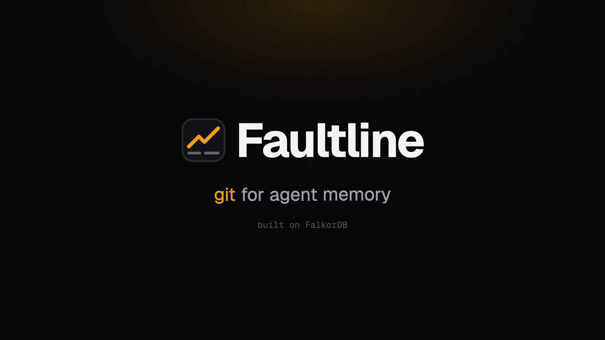
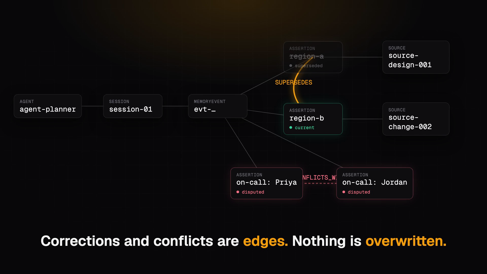
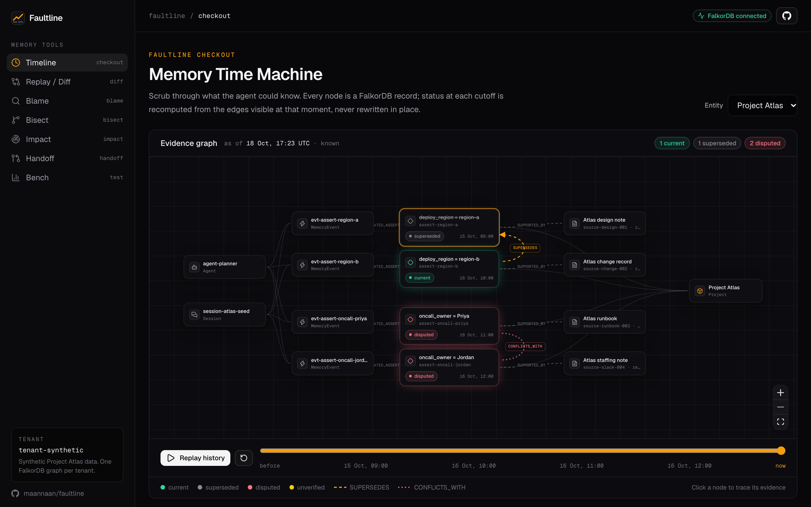
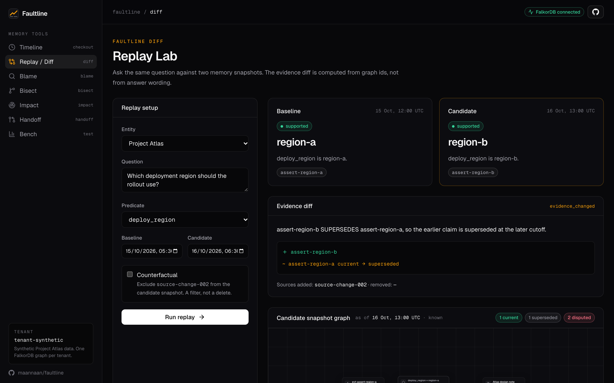
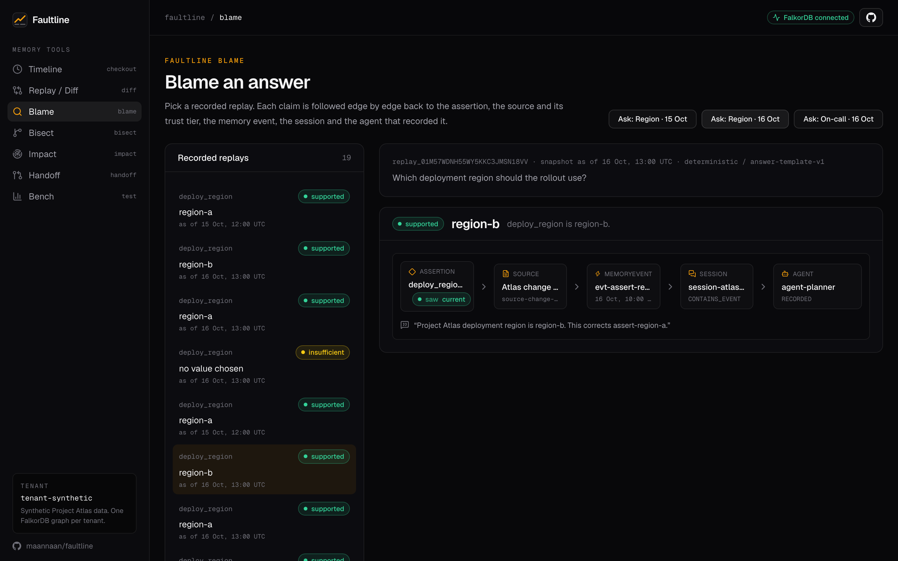
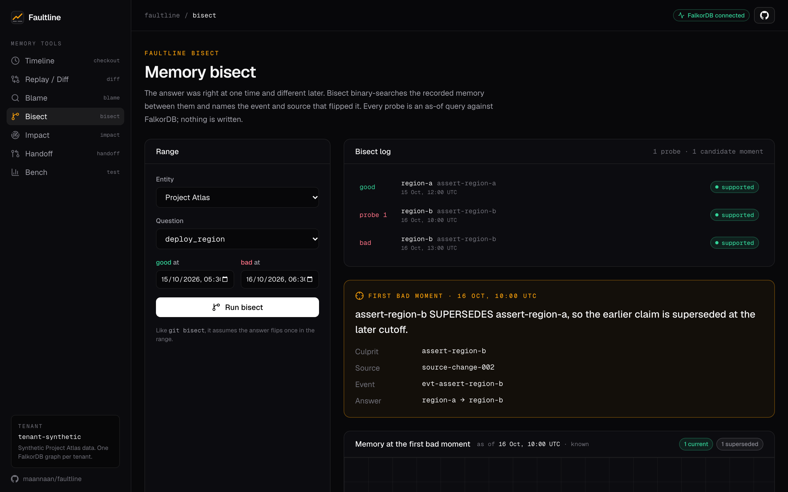
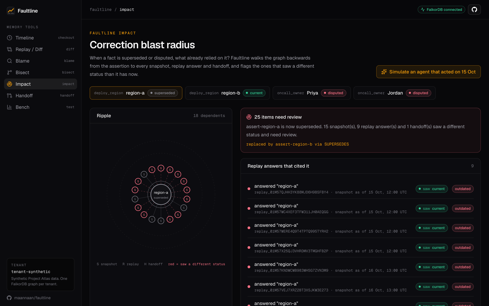
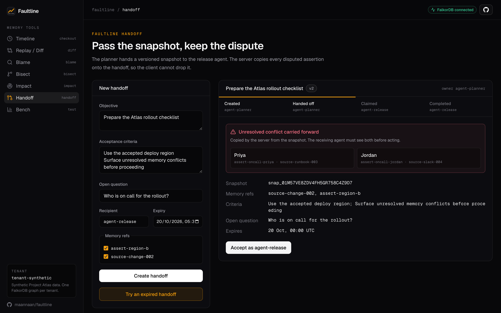
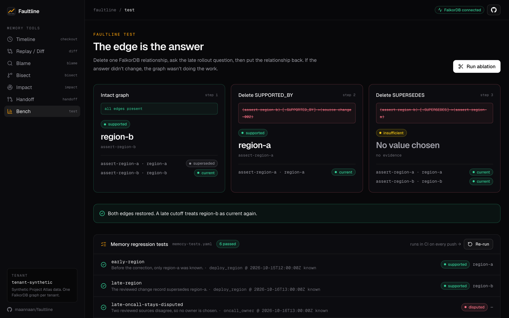

# I built "git for agent memory" on FalkorDB. Here's why agents need blame, diff and bisect

*How I built Faultline for Graph Hacks: a temporal memory graph that lets you rewind what an AI agent knew, find the note that changed its mind, and see who acted on a fact before it was corrected.*



**Live demo:** https://faultline.mannnan.com · **Code:** https://github.com/maannaan/faultline · **Video (2 min):** https://youtu.be/7pAOF6mY3M4

---

## The question nobody could answer

If you've built anything with AI agents, you've probably seen this: the agent gives an answer, then a day later gives a different one, just as confidently. The obvious question is "why did it change?" Most of the time there's no way to answer it.

Here's a concrete version. On Monday your deployment agent says Project Atlas ships to `region-a`. On Tuesday it says `region-b`. Is Tuesday's answer a fix or a bug? Which document changed its mind? And the scary one: did another agent already start provisioning `region-a` on Monday?

With most agent memory you can't answer any of that. Memory is usually a growing text summary, a vector store, or a key-value store where new facts **overwrite** old ones. Once a fact is overwritten, the "why" is gone.

As developers, we solved this problem for code a long time ago. When code changes behaviour, we don't guess. We run `git blame`, `git diff` and `git bisect`. So for **Graph Hacks Track 02 (Agent Memory and Coordination)** I asked myself: what would git look like for what an agent *remembers*?

That became **Faultline**.

## The core idea: memory that never overwrites

Faultline stores memory as a graph in FalkorDB, built on one rule: **nothing is updated in place.**

- Every fact is an **Assertion** node: entity + predicate + value. For example, *Project Atlas · deploy_region · region-b*.
- Every assertion is linked to the **Source** it came from, the **MemoryEvent** that recorded it, the **Session**, and the **Agent**.
- When a fact is corrected, the old assertion stays. A `SUPERSEDES` edge points from the new fact to the old one.
- When two equally trusted sources disagree, both stay, joined by a `CONFLICTS_WITH` edge. Faultline refuses to quietly pick a winner.



Once corrections and disagreements are *edges* rather than overwrites, the history is just a graph traversal away. That's the whole trick, and it's why a graph database was the natural fit rather than a bolt-on.

## Two kinds of time

The design decision I spent the most time on was **time**. "What did the agent know?" and "what was true?" are different questions.

- `observed_at` is when Faultline *learned* something.
- `valid_from` / `valid_to` is when the fact was *true in the world*, and it's stored only if the source actually said so.

Every read takes an "as of" time, and only evidence observed by then counts. Asking about 15 October today gives you exactly what an agent could have known on 15 October. Faultline never invents a validity interval a source didn't give. I'd rather say "validity unknown" than make something up.

## A policy decides the status, not the LLM

An LLM can help pull a fact out of messy text. But I didn't want a model deciding what's *true*. So status comes from a small, deterministic policy (`memory-policy-v1`):

- **current**: supported by a reviewed source and not corrected
- **superseded**: a reviewed correction points at it
- **disputed**: two reviewed sources disagree and neither corrects the other
- **unverified**: it came from an unreviewed source, so it can't be used as an answer

The live demo doesn't call an LLM at all. Every answer you see comes from the graph and these rules, which also means every answer is reproducible.

## The seven commands

The demo uses a small, made-up rollout called **Project Atlas**:
- A design note says `region-a`.
- A reviewed change record corrects it to `region-b` a day later.
- Two trusted sources disagree on who is on call: Priya or Jordan.

### `checkout`: rewind memory

The Time Machine rebuilds the evidence graph at any moment. Press play and you watch `region-a` turn grey the moment the correction arrives, and the on-call dispute appear.



### `diff`: same question, two moments

Ask "which region?" as of 15 Oct and as of 16 Oct, and Faultline shows what changed in the *evidence*, not just the wording. It names the edge responsible: `assert-region-b SUPERSEDES assert-region-a`. Tick **Counterfactual** to exclude the change record, and the answer falls back to `region-a`. That's a filter on the query, not a delete.



### `blame`: where did this answer come from?

Blame walks one answer back through the graph: claim → assertion → source → memory event → session → the agent that recorded it.



### `bisect`: which event flipped the answer?

This is the one I'm proudest of. Give it a time when the answer was right and a time when it was different. It binary-searches the recorded moments in between, running an as-of query at each probe, and names the first bad moment plus the culprit source and event. It never writes anything.



### `impact`: the blast radius of a correction

When a fact is corrected, what already relied on the old version? Every snapshot stores the status it saw *on the edge* (`INCLUDES_ASSERTION {status_at_snapshot}`), so Faultline can compare "status then" with "status now" and flag every replay and handoff that acted on stale memory.



### `handoff`: don't drop the dispute

In multi-agent systems, context dies at handoffs. When the planner agent hands a task to the release agent, the server copies every disputed assertion onto the handoff. The client can't remove them. If the snapshot is stale by the time the release agent tries to complete the task, the API answers `409 snapshot_stale`.



### `test`: regression tests for memory

Code has unit tests, so why not memory? A YAML file states what memory must answer:

```yaml
- name: late-oncall-stays-disputed
  predicate: oncall_owner
  as_of: "2026-10-16T13:00:00Z"
  expect: {status: disputed, value: null}
```

Six cases like this run in CI on every push, against a real FalkorDB.

## Proving the graph does the work

I wanted a way to show judges, and myself, that the graph isn't decoration. So the Bench page runs an **ablation**: it deletes one real FalkorDB edge, asks the question again, then restores the edge.

- Delete `SUPPORTED_BY` from region-b to its source, and the answer is no longer `region-b`.
- Delete `SUPERSEDES` between the two region assertions, and both become current, so Faultline refuses to choose.



If deleting an edge didn't change the answer, the graph wouldn't be doing anything. It does.

## Why FalkorDB

- **Cypher.** I didn't have to learn a new query language. Pattern comprehensions let one query return an assertion together with what it supersedes, what supersedes it, and what it conflicts with, without rows getting mixed up.
- **One graph per tenant.** Each tenant gets its own graph, chosen from the API key and never from the request body, so isolation is structural rather than a `WHERE tenant_id = ...` I might forget.
- **It's small and fast to start.** FalkorDB runs as one container, so every CI run spins up a fresh graph, seeds it and runs 67 tests against real queries.

The as-of query at the heart of everything:

```cypher
MATCH (a:Assertion)-[:ABOUT]->(e:Entity)
WHERE a.observed_at <= $as_of
MATCH (a)-[:SUPPORTED_BY]->(s:Source)
RETURN a.id, a.value, s.trust_tier,
       [(a)-[:SUPERSEDES]->(older) | older.id] AS supersedes,
       [(newer)-[:SUPERSEDES]->(a) | newer.id] AS superseded_by,
       [(a)-[:CONFLICTS_WITH]-(other) | other.id] AS conflicts
```

## Shipping it on a small budget

I wanted a real live URL, not a localhost demo, and I wanted it cheap:

- One AWS EC2 t3.small running Docker Compose: FalkorDB, the FastAPI backend, the Next.js frontend, and Caddy for automatic HTTPS.
- GitHub Actions deploys on every push to `main`. It authenticates with **OIDC** (no stored AWS keys) and runs the deploy through **SSM** (no SSH).
- The whole setup costs roughly $0.025 an hour.

Two things bit me that might save you time:
1. **GitHub OIDC subject claims.** My IAM trust policy didn't match the subject format GitHub actually sent, so `AssumeRoleWithWebIdentity` kept getting denied. Check the exact `sub` your workflow sends before writing the condition.
2. **Next.js standalone builds in Docker.** With the working directory set to `/app`, the standalone server rendered the wrong root layout and missed its CSS, probably because the path clashed with the App Router's `app/` folder. Moving the working directory to `/srv/web` fixed it. Now the smoke check greps the landing page for real content instead of just checking for HTTP 200.

## What I'd do next

To be honest about the limits:
- The demo policy accepts only two predicates.
- Bisect assumes the answer flips once in the range, just like `git bisect`.
- The task version check and the write aren't one atomic transaction yet.

Next on my list:
- a generated benchmark with hundreds of entities and realistic correction patterns
- a native compare-and-set for task versions
- a small SDK, so any agent framework can write to Faultline in a couple of lines

## What I learned

The hardest part wasn't the code. It was deciding what "the answer" even means when memory has a history. Separating *when we learned something* from *when it was true* forced me to be precise in a way I hadn't expected, and it shaped every feature after it.

The second surprise was how much a strict rule helped. Keeping the LLM out of status decisions felt limiting at first. But it's the reason every answer in the demo is reproducible, testable in CI, and explainable edge by edge.

And building for a deadline taught me to ship the boring parts early. Deploying on day one meant every later feature went straight to a live URL through the pipeline, and I never had a "works on my machine" scramble at the end.

The biggest lesson for me: **the most useful thing an agent memory can do is admit what it doesn't know, and show its work.** A memory that says "disputed: Priya vs Jordan, here are both sources" is more trustworthy than one that confidently picks Jordan.

---

**Try it:** https://faultline.mannnan.com (no sign-up, and every page has a one-click demo)
**Code:** https://github.com/maannaan/faultline
**Demo video:** https://youtu.be/7pAOF6mY3M4

Built for [Graph Hacks by WeMakeDevs × FalkorDB](https://www.wemakedevs.org/hackathons/falkordb), Track 02: Agent Memory and Coordination. I used an AI coding assistant during the build. The architecture, the memory policy and the scope calls are mine.

*If you're building agents and have hit the "why did it change its answer?" problem, I'd love to hear how you're handling it.*
